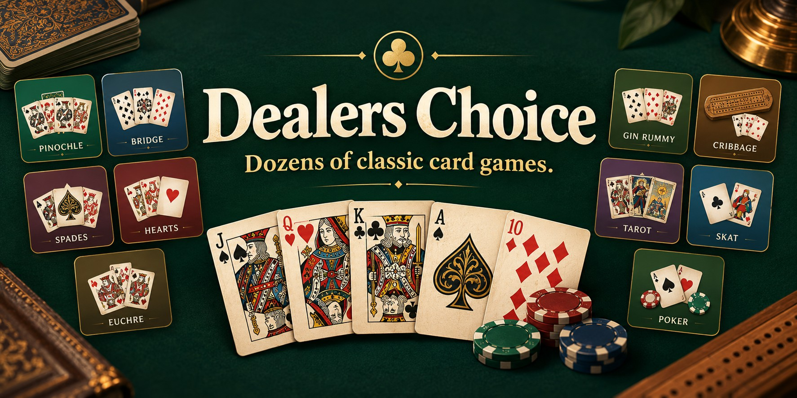
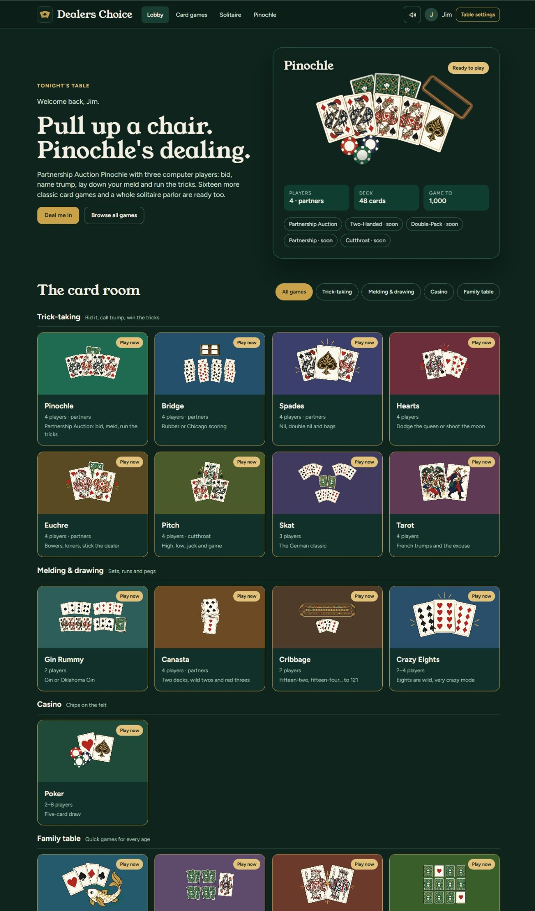

<p align="center">
  
</p>

<h1 align="center">Dealer's Choice</h1>

<p align="center">
  <b>A warm, old-fashioned card room in your browser.</b><br>
  Seventeen classic card games, a fifty-one-layout solitaire parlor, eleven casino games on one
  shared bankroll, and a table full of friendly opponents.
</p>

<p align="center">
  <a href="https://jimerb.github.io/Dealers-Choice/"><b>▶&nbsp;&nbsp;Play now</b></a>
  &nbsp;&nbsp;·&nbsp;&nbsp;
  <a href="#the-games">The games</a>
  &nbsp;&nbsp;·&nbsp;&nbsp;
  <a href="#the-solitaire-parlor">Solitaire parlor</a>
  &nbsp;&nbsp;·&nbsp;&nbsp;
  <a href="#the-casino">The casino</a>
  &nbsp;&nbsp;·&nbsp;&nbsp;
  <a href="#play-it-on-your-own-computer">Run it locally</a>
</p>

---

Pull up a chair, pick a table and play the card games you grew up with: bid a Pinochle hand with
your partner, shoot the moon in Hearts, peg your way to 121 in Cribbage, or settle into the
solitaire parlor for a quiet hand on your own. Or step into the casino, place your chips and let
the wheel, the dice or the cards decide. No sign-up, no downloads, nothing to install.
Open the page and the cards are dealt.

Dealer's Choice has its own look and sound throughout: the **Parlor** card deck and table felts,
a cast of twelve characters to play against, a relaxed lounge-jazz soundtrack and original sound
effects, all made for this game.

## The games

### 🂡 Trick-taking
*Bid it, call trump, win the tricks.*

| Game | Players | What you're in for |
|---|---|---|
| **Pinochle** | 2 or 4 | Five ways to play: Partnership Auction, Two-Handed, Double-Pack, Partnership and Cutthroat |
| **Bridge** | 4 · partners | A full auction and play, with Rubber or Chicago scoring |
| **Spades** | 4 · partners | Bid your tricks, risk a nil or double nil, and watch out for bags |
| **Hearts** | 4 | Pass three, dodge the queen of spades, or shoot the moon |
| **Euchre** | 4 · partners | Bowers, loners and stick the dealer |
| **Pitch** | 4 · cutthroat | High, low, jack and game |
| **Skat** | 3 | The German classic: bid, pick up the skat and declare your game |
| **Tarot** | 4 | The French game of trumps, bouts and the Excuse |

### 🃏 Melding and drawing
*Sets, runs and pegs.*

| Game | Players | What you're in for |
|---|---|---|
| **Gin Rummy** | 2 | Build your melds and knock, or hold out for gin; Oklahoma Gin too |
| **Canasta** | 4 · partners | Two decks, wild twos and jokers, red threes and canastas |
| **Cribbage** | 2 | Fifteen-two, fifteen-four… pegging your way around the board to 121 |
| **Crazy Eights** | 2–4 | Eights are wild, with a *very* crazy mode |

### 🎲 Poker
*Chips on the felt.*

| Game | Players | What you're in for |
|---|---|---|
| **Poker** | 2–6 | Five-card draw against the table: ante up, bet, raise, draw and bluff |

### 🐟 Family table
*Quick games for every age.*

| Game | Players | What you're in for |
|---|---|---|
| **Go Fish** | 4 | Got any fives? |
| **Old Maid** | 4 | Don't get stuck with the odd card |
| **War** | 2 | Flip, compare and declare war |
| **Memory Match** | 1–2 | Turn them over and find every pair |

## The solitaire parlor

Fifty-one solitaire layouts, each with its own *How to play* card, plus Undo, Auto-finish and a
fresh deal whenever you want one.

| | Layouts |
|---|---|
| **One deck** | Aces Up · Baker's Dozen · Baroness · Beleaguered Castle · Betsy Ross · Bowling · Bristol · Calculation · Canfield · Clock · Cribbage Square · Eagle Wing · Eight Off · Eliminator · Euchre · Flower Garden · Fortress · Four Free · Four Seasons · Gaps · Golf · Klondike · Klondike (draw 3) · La Belle Lucie · Nestor · Penguin · Poker Square · Pyramid · Scorpion · Seahaven Towers · Shamrocks · Slide · Spiderette · Strategy · Triplets · Yukon |
| **Two decks** | Aces and Kings · Alhambra · Batsford · Colorado · Forty Thieves · Mount Olympus · Red and Black · Spider · Sultan · Terrace |
| **Arcade** | 3 Towers · Best 21 · Fast 21 · Pick 2 · Sum 11 *(timed, scored rounds)* |

## The casino

*Step up to the tables.* Eleven games, one bankroll. Everything is play money, and every game uses the
same bank, so a win at the blackjack table pays for your next spin at the slots.

### Table games

| Game | Players | What you're in for |
|---|---|---|
| **Blackjack** | 1 | Beat the dealer to 21. Six decks, blackjack pays 3 to 2, with insurance, doubles, splits, surrender and a basic-strategy hint |
| **Roulette** | 1 | American or European wheel. Inside bets, splits, streets, corners, six lines, the zero bets, and the half-back rule |
| **Craps** | 1 | Pass, don't pass, come and don't come, with odds. Place, buy and lay bets, hardways, the field and the one-roll bets |
| **Baccarat** | 1 | Player, Banker or tie, with the full third-card rules and a scorecard of recent results |
| **Three Card Poker** | 1 | Ante and play against the dealer, with a Pair Plus side bet and an ante bonus |
| **Let It Ride** | 1 | Three bets on the same hand. Pull back the first two as the cards come, and let the rest ride |
| **Caribbean Stud** | 1 | Five-card stud against the dealer, with a raise decision and an optional $1 bonus bet |
| **Pai Gow Poker** | 1 | Set your seven cards into a high hand and a low hand, or let the house way do it for you |

### Machines

| Game | Players | What you're in for |
|---|---|---|
| **Video Poker** | 1 | Jacks or Better, Bonus Poker and Deuces Wild, with a hint that shows the best hold |
| **Slots** | 1 | *Brass Crown*: three reels, one pay line, one to three coins, and autoplay |
| **Keno** | 1 | Mark up to ten numbers on a ticket and watch the balls come out of the blower |

### Your bankroll

- **One bank for everything.** You start with $5,000 and the bank follows you from game to game.
- **Tiers.** Your credit card rises from Brass through Silver, Gold, Emerald, Sapphire and Onyx as
  your bank grows. Each tier has its own medallion and card.
- **Loans.** If you run dry, the loan desk will lend you money based on your tier. It is repaid
  automatically once you're winning again.
- **Stakes.** Table games come in four stake levels, from $5–$1,000 up to a no-limit table. Machines
  take $1, $5 or $25 at a time.
- **Hall of Fame.** Reach a billion dollars on Onyx and your name goes on the wall. Your bank then
  starts again at $5,000.
- **Stats.** Every game keeps its own record of hands played, money wagered, won and net.

## Step into the card room

<p align="center">
  
</p>

The lobby is the front door to the three rooms: **Card games**, the **Solitaire parlor** and the
**Casino**. Each room shows a few featured games, and a *More* tile takes you to the full list.

- **A cast of characters.** Twelve computer partners and opponents, each with a portrait and a
  personality, who bid, meld and play by each game's real rules: careful Mabel, flashy Dex, the
  Colonel, chatty Rosa, Hank, Pip, Odette, gentle Gus, by-the-book Nova, the Captain, Lou and Ivy.
  Some have favourite games, so you may find Odette waiting at the Tarot table and the Captain at
  the cribbage board.
- **The Parlor deck.** A mid-century card design in cream, ink, brass and deep green, with
  double-ended court cards, its own jokers and a fully illustrated Tarot.
- **Make the table yours.** Six card backs and six table surfaces (green, oxblood and midnight
  felt, walnut, linen and slate), a classic drawn deck if you prefer, and your own portrait at the
  table. It's all under **Table settings**.
- **Real table pieces.** A dealer button, chip stacks at the poker table, a wooden cribbage board
  with brass and red pegs, a tray for passing cards and a trump marker on the felt.
- **Music that follows you.** Six original lounge-jazz tracks play in a shuffled order that carries
  on seamlessly as you move between the lobby and the tables, and never repeats a song back to back.
- **Sounds of the table.** Dealing, shuffling, tricks, chips and wins, with separate volume
  controls for music and game sounds.
- **Remembers you.** Your name, portrait, card style, card back, table and volumes are kept in your
  browser, and games in progress pick up where you left off.
- **Plays anywhere.** Desktop, tablet or phone, in any modern browser.

## Play it on your own computer

You need [Node.js](https://nodejs.org/) 20 or newer. There is nothing else to install.

```bash
git clone https://github.com/jimerb/Dealers-Choice.git
```

```bash
cd Dealers-Choice/web && npm start
```

Then open <http://localhost:4449>. To run the test suite:

```bash
cd Dealers-Choice/web && npm test
```

## How it's built

A small web app with no dependencies and no build step: plain HTML, CSS and JavaScript modules,
served by a tiny Node server locally and by GitHub Pages online.

```
web/server.mjs                 local server
web/public/index.html          site shell: hosts the music player and shows every screen in a frame
web/public/lobby.html          the lobby
web/public/play.html           the shared table that runs most of the card games
web/public/games.html          every card game, with filters
web/public/pinochle.html       the Pinochle table
web/public/solitaire.html      the solitaire parlor
web/public/casino.html         the casino: table games, machines and the shared bank
web/public/js/games/           one rules engine and computer player per card game
web/public/js/solitaire/       the solitaire engine and layouts
web/public/js/casino/          the casino shell, the game modules and their rules engines
web/public/js/casino/kit/      the shared pieces: random numbers, the shoe, poker hands, bets and money
web/public/js/core/bank.js     the casino bank: balance, tiers, loans and stats
web/public/js/core/            cards, table, cast, table pieces, sound and music
web/public/js/skin.js          card styles, backs and table surfaces
web/public/assets/             card art, felts, portraits, table pieces, casino art, sounds and music
web/test/                      rules, engine and payout tests
art/parlor/                    source art, print-quality card masters and proof sheets
tools/art/                     scripts that build the card deck, the table art and the sound effects
```

To rebuild the Parlor deck or the sound effects after changing their sources, run these from the
repository root:

```bash
python3 -I tools/art/build_parlor.py
```

```bash
python3 -I tools/art/build_sounds.py
```

<p align="center"><i>Shuffle up and deal.</i> ♠ ♥ ♣ ♦</p>
